# CMS Analytics Studio — User Guide

CMS Analytics Studio puts your **Instagram, Facebook, YouTube and LinkedIn** numbers in one place, lets you **publish one post to all of them**, and **auto-replies on Instagram** when someone comments or messages a keyword like "link".

Web address: **https://cms.changtechs.com**

> 📄 **Word version:** [CMS-Analytics-Studio-User-Guide.docx](CMS-Analytics-Studio-User-Guide.docx)

> **How to read this guide:** every screenshot has **red numbered labels**. The table under each picture explains what each number is and what to do with it. Example: *"Figure 4 → ③"* means label number 3 in Figure 4.

---

## Contents

| # | Section | Figures |
|---|---|---|
| 1 | [Signing in](#1-signing-in) | Fig 1 |
| 2 | [Finding your way around](#2-finding-your-way-around) | Fig 2–3 |
| 3 | [Overview — all platforms at once](#3-overview--all-platforms-at-once) | Fig 4–6 |
| 4 | [Platform workspace basics](#4-platform-workspace-basics) | Fig 7 |
| 5 | [Instagram](#5-instagram) | Fig 8–13 |
| 6 | [Facebook](#6-facebook) | Fig 14–15 |
| 7 | [YouTube](#7-youtube) | Fig 16–18 |
| 8 | [LinkedIn](#8-linkedin) | Fig 19 |
| 9 | [Social Post — publish everywhere](#9-social-post--publish-everywhere) | Fig 20–22 |
| 10 | [Auto-replies (Instagram)](#10-auto-replies-instagram) | Fig 23–27 |
| 11 | [Connected accounts](#11-connected-accounts) | Fig 28–29 |
| 12 | [My profile and logging out](#12-my-profile-and-logging-out) | Fig 30 |
| 13 | [How the data is updated](#13-how-the-data-is-updated) | — |
| 14 | [Glossary](#14-glossary) | — |
| 15 | [Troubleshooting and FAQ](#15-troubleshooting-and-faq) | — |

---

## 1. Signing in

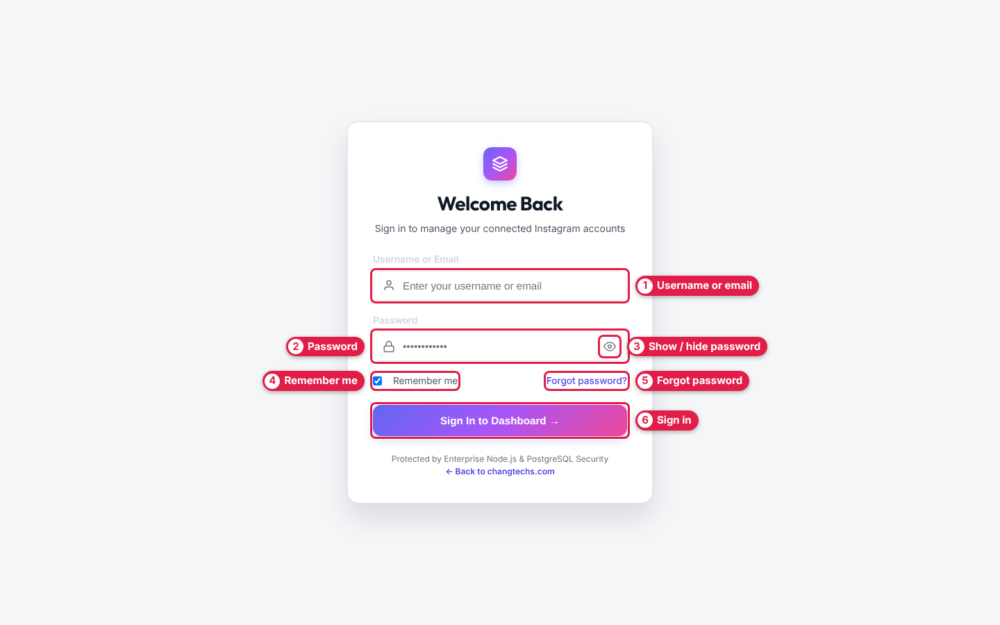

*Figure 1 — Sign in page*

| # | Label | What to do |
|---|---|---|
| ① | Username or email | Type your username (e.g. `chang`) or your email address. |
| ② | Password | Type your password. |
| ③ | Show / hide password | Click the eye to check what you typed. |
| ④ | Remember me | Keep it ticked to stay signed in on this browser. |
| ⑤ | Forgot password | Passwords are reset by your administrator — contact them. |
| ⑥ | Sign in | Click to open the dashboard. You land on **Overview** (Figure 4). |

---

## 2. Finding your way around

### Top menu bar

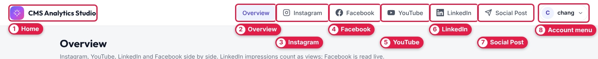

*Figure 2 — Top menu bar (visible on every page)*

| # | Label | Opens |
|---|---|---|
| ① | Home | Goes back to Overview. |
| ② | Overview | All accounts side by side — [section 3](#3-overview--all-platforms-at-once). |
| ③ | Instagram | Instagram analytics — [section 5](#5-instagram). |
| ④ | Facebook | Facebook Page analytics — [section 6](#6-facebook). |
| ⑤ | YouTube | YouTube channel analytics — [section 7](#7-youtube). |
| ⑥ | LinkedIn | LinkedIn company page analytics — [section 8](#8-linkedin). |
| ⑦ | Social Post | Write and publish a post — [section 9](#9-social-post--publish-everywhere). |
| ⑧ | Account menu | Opens the menu in Figure 3. |

On a phone, tap the **☰** icon to open this menu.

### Account menu

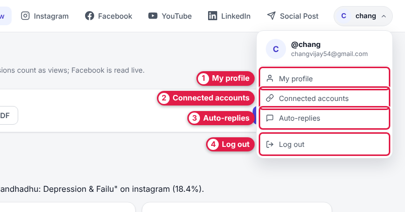

*Figure 3 — Account menu (click your name, Figure 2 → ⑧)*

| # | Label | Opens |
|---|---|---|
| ① | My profile | Your details — [section 12](#12-my-profile-and-logging-out). |
| ② | Connected accounts | Add or fix social accounts — [section 11](#11-connected-accounts). |
| ③ | Auto-replies | Instagram keyword replies — [section 10](#10-auto-replies-instagram). |
| ④ | Log out | Signs you out of this browser. |

---

## 3. Overview — all platforms at once

### Controls and totals

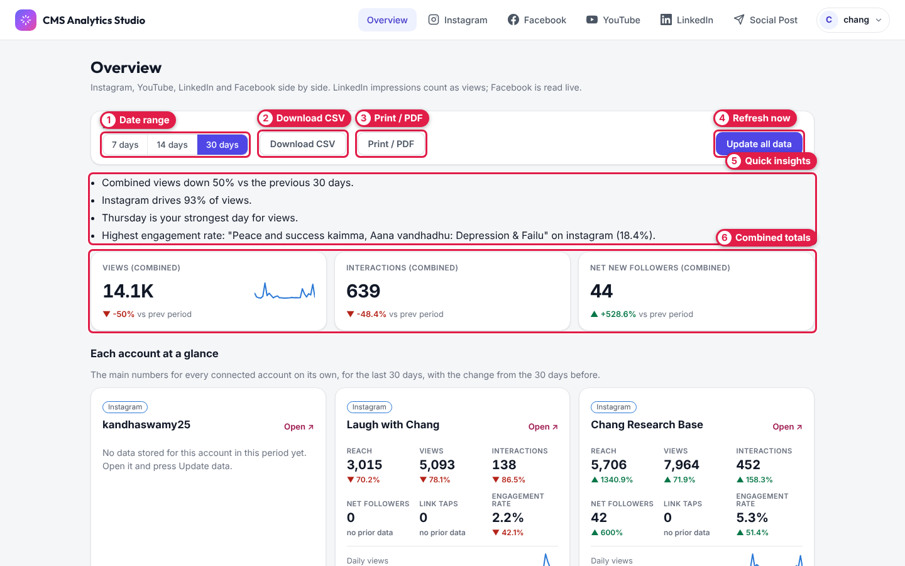

*Figure 4 — Overview page, top*

| # | Label | What it does |
|---|---|---|
| ① | Date range | Choose 7, 14 or 30 days. Every number is compared with the same number of days just before. |
| ② | Download CSV | Downloads the numbers as a spreadsheet (opens in Excel / Google Sheets). |
| ③ | Print / PDF | Print the page, or choose "Save as PDF" in the print window. |
| ④ | Refresh now (*Update all data*) | Fetches the latest numbers from every platform immediately. |
| ⑤ | Quick insights | Plain sentences such as "Instagram drives 93% of views". |
| ⑥ | Combined totals | Views, interactions and new followers across all platforms. ▲ green = up, ▼ red = down vs the previous period. |

### Each account at a glance

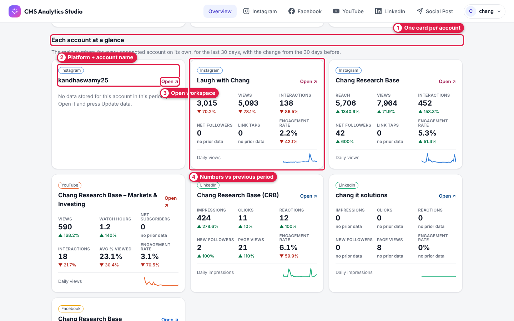

*Figure 5 — One card per connected account*

| # | Label | What it means |
|---|---|---|
| ① | One card per account | Every connected Instagram, YouTube, LinkedIn and Facebook account gets a card. |
| ② | Platform + account name | Which platform and which account the card is for. |
| ③ | Open workspace | Click **Open ↗** to see that account in detail (Figure 7). |
| ④ | Numbers vs previous period | Key numbers with % change. If the card says *"No data stored…"*, open it and press **Update data**. |

### Charts and best content

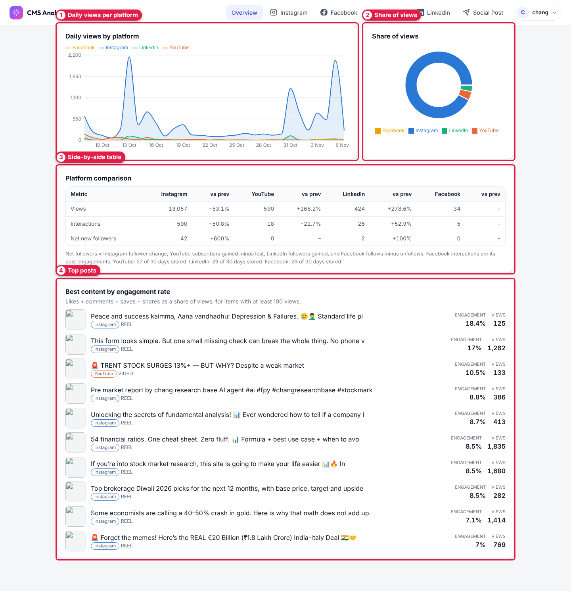

*Figure 6 — Overview page, lower half*

| # | Label | What it shows |
|---|---|---|
| ① | Daily views per platform | Line chart of daily views, one colour per platform. |
| ② | Share of views | Which platform brings most of your views. |
| ③ | Side-by-side table | Views, interactions and new followers per platform, with % change. |
| ④ | Top posts | Your best posts/videos by engagement rate (only items with 100+ views). |

> LinkedIn *impressions* count as views here. Facebook numbers are read live.

---

## 4. Platform workspace basics

Instagram, Facebook, YouTube and LinkedIn pages all share the same layout.

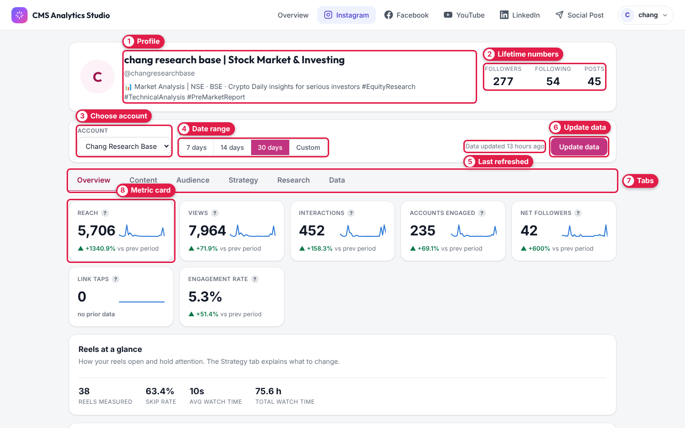

*Figure 7 — Platform workspace (Instagram shown)*

| # | Label | What to do |
|---|---|---|
| ① | Profile | Account name, handle and bio. |
| ② | Lifetime numbers | Followers, following and posts right now. |
| ③ | Choose account | If you have several accounts on this platform, pick one here. |
| ④ | Date range | 7 / 14 / 30 days, or **Custom** for exact dates (custom ranges load live and can be slower). |
| ⑤ | Last refreshed | When the numbers were last updated. |
| ⑥ | Update data | Click to refresh now (takes a few seconds). |
| ⑦ | Tabs | Overview, Content, Audience, Strategy, Research, Data (each explained below). |
| ⑧ | Metric card | Big number = total for the period; ▲/▼ = change vs previous period; small line = daily trend. Hover the **?** for an explanation. "no prior data" = nothing to compare yet. |

The **Overview** tab also has *Reels at a glance*, *Stories at a glance*, **What your data says** (plain language takeaways) and **More numbers**.

---

## 5. Instagram

### Content tab

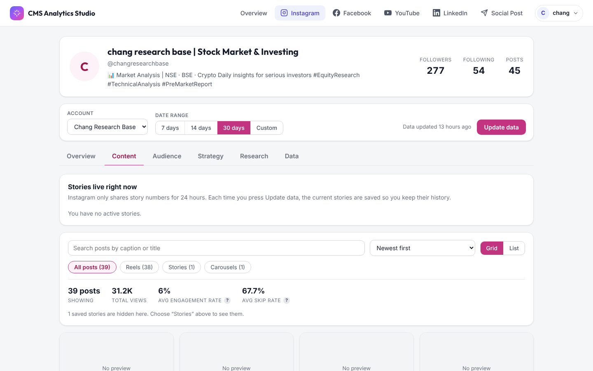

*Figure 8 — Instagram → Content*

| # | Label | What to do |
|---|---|---|
| ① | Search captions | Find a post by words in its caption. |
| ② | Sort | Newest, most views, best engagement, most likes/comments/saves/shares, lowest skip rate, longest watch time. |
| ③ | Grid / List | Switch between cards and a compact list. |
| ④ | Filter by type | All posts, Reels, Stories, Carousels. |
| ⑤ | Post card | Views, reach, likes, comments, saves, shares, skip rate and average watch time for one post. |
| ⑥ | Open on Instagram | Opens the post in Instagram. |
| ⑦ | Add auto-reply | Opens the auto-reply form already set to this post (Figure 24). |
| ⑧ | Comment insights | Summary of the comments on this post. |

> **Stories:** Instagram keeps story numbers for only 24 hours. The app saves them every 6 hours (and whenever you press Update data) so you keep their history.

### Audience tab

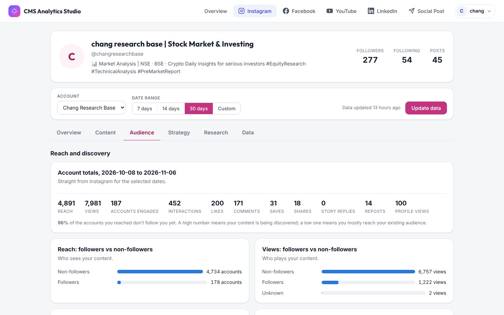

*Figure 9 — Instagram → Audience*

| # | Label | What it tells you |
|---|---|---|
| ① | Followers vs new people | How many accounts reached were followers vs people who don't follow you. High share of people who don't follow you = you're being discovered. |
| ② | Views split | Same split for views. |
| ③ | Views by format | Views from reels, posts and stories. |
| ④ | Reach by format | Which format finds new people. |

Further down this tab: follows vs unfollows, saves/shares/likes/comments by format, **Best time to post** heat map, and follower **age, gender, countries and cities**.

> Instagram only provides demographics and "best time to post" for accounts with **100+ followers**.

### Strategy tab

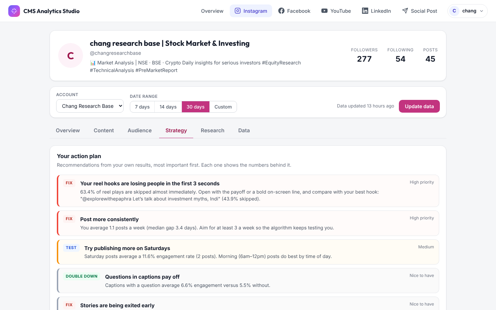

*Figure 10 — Instagram → Strategy (action plan)*

| # | Label | What it means |
|---|---|---|
| ① | Action plan | Recommendations made from your own results, most important first. |
| ② | Recommendation | One tip, with the numbers behind it (e.g. "Post more consistently"). |
| ③ | Priority | *High priority*, *Medium* or *Nice to have* — start with High. |

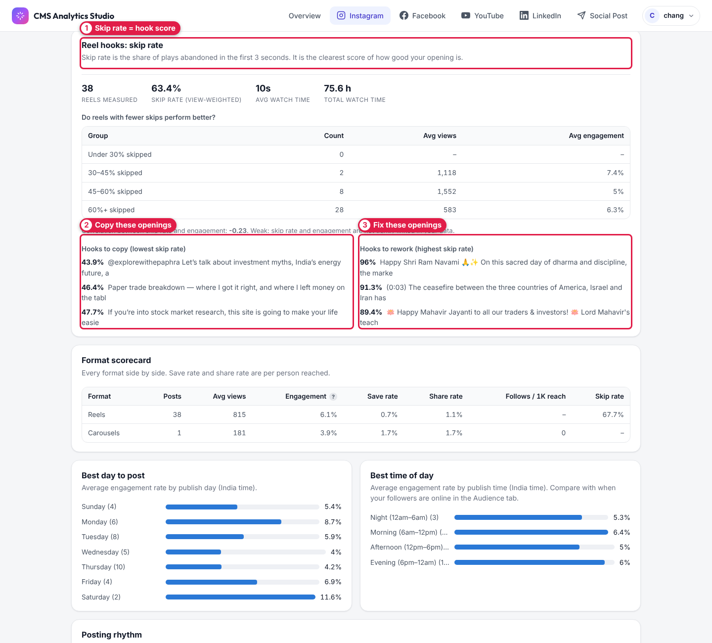

*Figure 11 — Instagram → Strategy (reel hooks)*

| # | Label | What it means |
|---|---|---|
| ① | Skip rate = hook score | % of plays that stop in the first 3 seconds. Lower is better. |
| ② | Copy these openings | Your reels with the lowest skip rate — reuse their style. |
| ③ | Fix these openings | Your reels with the highest skip rate — rework the first 3 seconds. |

Below this: the **Format scorecard** comparing reels, carousels and images.

### Research tab

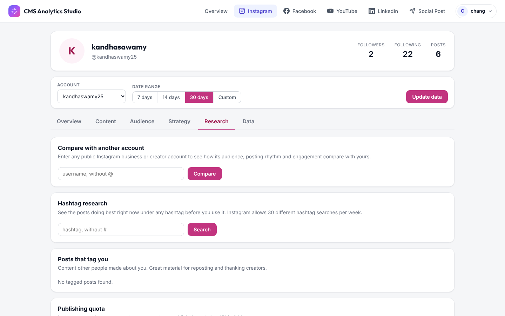

*Figure 12 — Instagram → Research*

| # | Label | What to do |
|---|---|---|
| ① | Compare with competitor | Type any public Business/Creator username and click **Compare**. |
| ② | Hashtag research | Type a hashtag and click **Search** to see its top posts. Limit: 30 different hashtags per week. |
| ③ | Posts that tag you | Content others made about you — good for reposting. |
| ④ | Daily posting limit | Posts published through the app in the last 24 hours, out of Instagram's limit (100). |

### Data tab

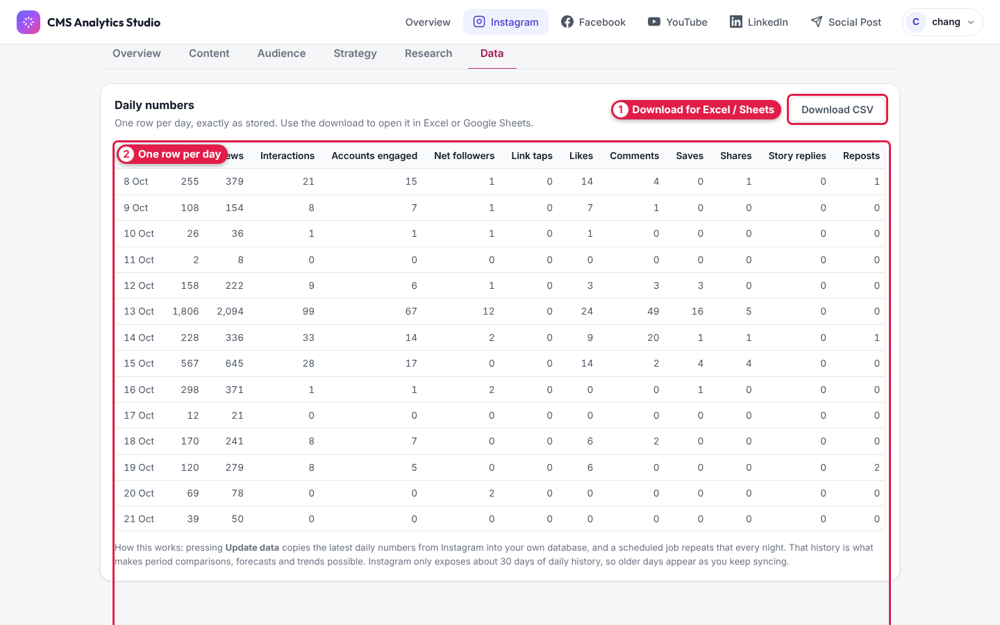

*Figure 13 — Instagram → Data*

| # | Label | What to do |
|---|---|---|
| ① | Download for Excel / Sheets | Click **Download CSV**. |
| ② | One row per day | Daily reach, views, interactions, followers, likes, comments, saves, shares and more. |

---

## 6. Facebook

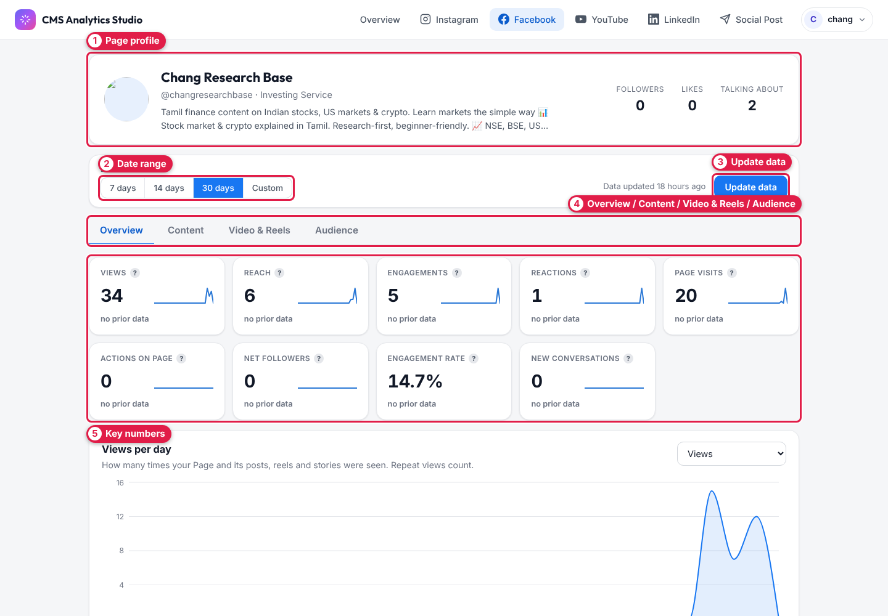

*Figure 14 — Facebook → Overview*

| # | Label | What to do |
|---|---|---|
| ① | Page profile | Page name, category, bio, followers and likes. |
| ② | Date range | 7 / 14 / 30 days or Custom. |
| ③ | Update data | Refresh now. |
| ④ | Tabs | **Overview**, **Content** (every post with its numbers, best type/day/time to post), **Video & Reels** (views, minutes watched, table for each reel), **Audience**. |
| ⑤ | Key numbers | Views, reach, engagements, reactions, page visits, actions, net followers, engagement rate, new conversations. |

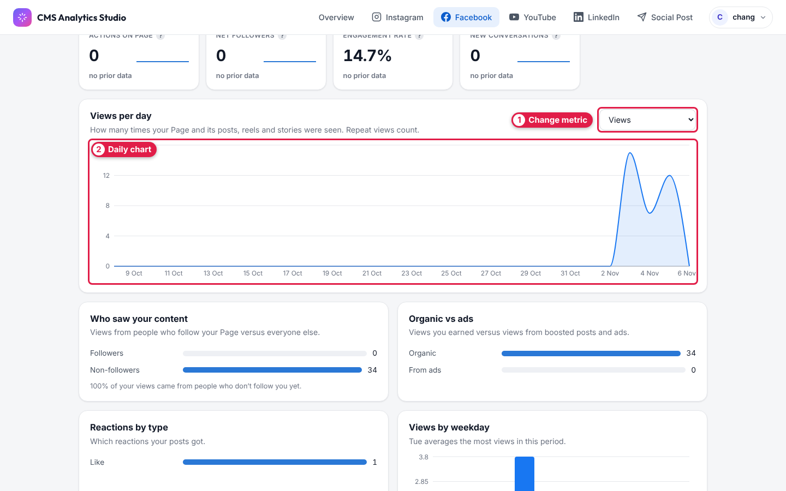

*Figure 15 — Facebook daily chart*

| # | Label | What to do |
|---|---|---|
| ① | Change metric | Pick which number the chart shows (views, reach, follows, video views…). |
| ② | Daily chart | One point per day. Below it: followers vs people who don't follow you, organic vs ads, reactions by type, views by weekday. |

---

## 7. YouTube

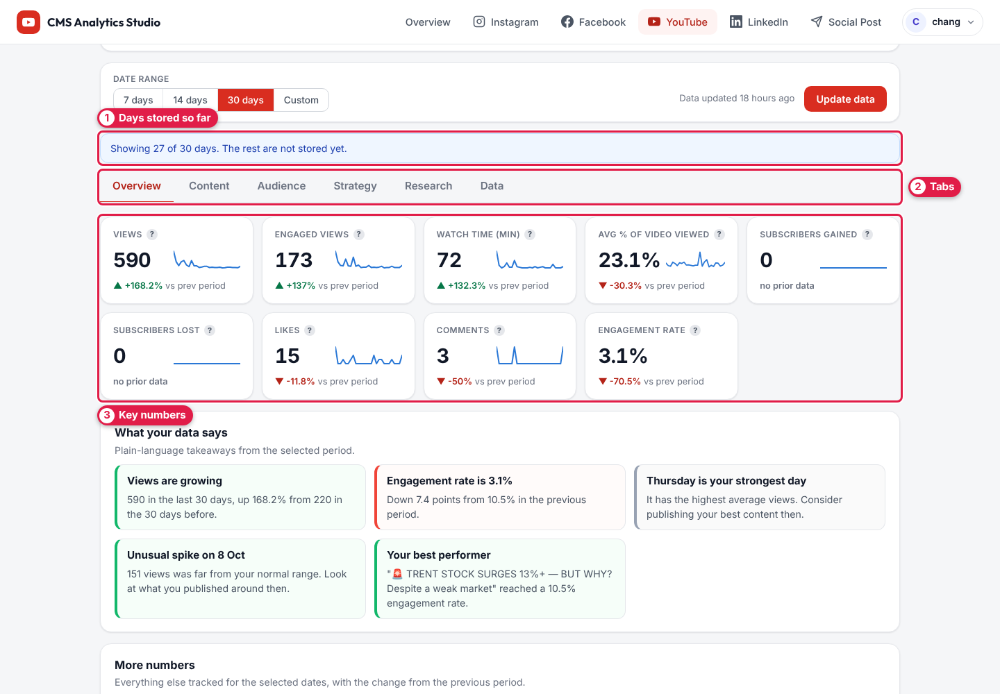

*Figure 16 — YouTube → Overview*

| # | Label | What it means |
|---|---|---|
| ① | Days stored so far | e.g. "Showing 27 of 30 days" — a few days aren't saved yet. Press **Update data** or wait for the nightly update. |
| ② | Tabs | Overview, Content, Audience, Strategy, Research, Data. |
| ③ | Key numbers | Views, engaged views, watch time, avg % viewed, subscribers gained/lost, likes, comments, engagement rate. |

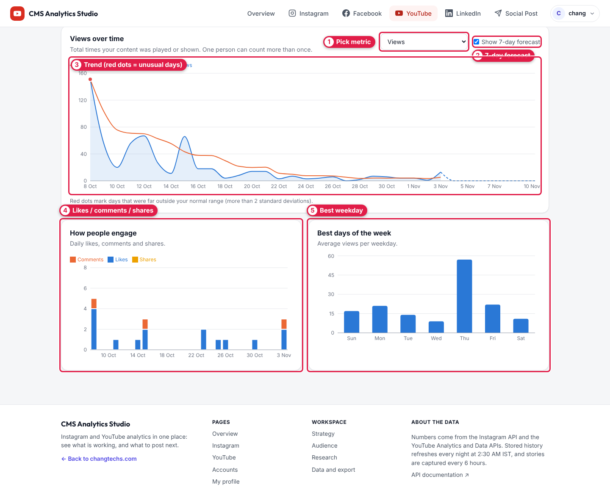

*Figure 17 — YouTube charts*

| # | Label | What to do |
|---|---|---|
| ① | Pick metric | Choose what the chart shows. |
| ② | 7-day forecast | Tick to see a projection for the next 7 days. |
| ③ | Trend (red dots = unusual days) | Red dots mark days far outside your normal range — check what you posted then. |
| ④ | Likes / comments / shares | Daily engagement. |
| ⑤ | Best weekday | Average views per weekday — publish your best videos on the tallest bar. |

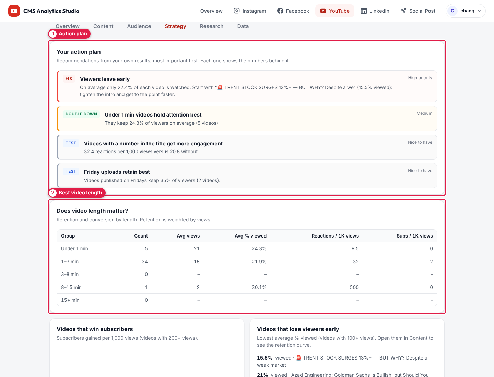

*Figure 18 — YouTube → Strategy*

| # | Label | What it means |
|---|---|---|
| ① | Action plan | Tips such as "Viewers leave early", with priority. |
| ② | Best video length | Retention and subscribers by video length. Further down: videos that win subscribers, videos that lose viewers early, and title patterns. |

The **Content** tab lists every video (search, sort, open on YouTube, comment insights). The **Data** tab has the daily table and **Download CSV**.

---

## 8. LinkedIn

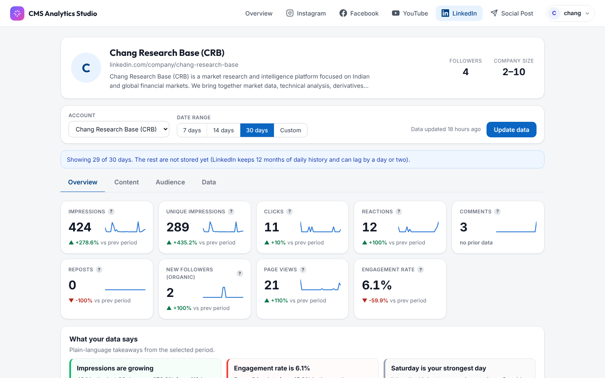

*Figure 19 — LinkedIn → Overview*

| # | Label | What to do |
|---|---|---|
| ① | Company page | Page name, link, description, followers, company size. |
| ② | Switch page | Choose which company page to view. |
| ③ | Date range | 7 / 14 / 30 days or Custom. |
| ④ | Update data | Refresh now. |
| ⑤ | Tabs | Overview, Content (each post's impressions, clicks, CTR, reactions), Audience, Data (CSV). |
| ⑥ | Key numbers | Impressions, unique impressions, clicks, reactions, comments, reposts, new followers, page views, engagement rate. |

> LinkedIn keeps 12 months of daily history and can lag by a day or two.

---

## 9. Social Post — publish everywhere

Write once, publish (or schedule) to Instagram, Facebook, LinkedIn and YouTube. Steps: **Platform → Account → Content → Auto reply → Review**. Your work is saved as a draft automatically.

### Step 1 — Choose platforms

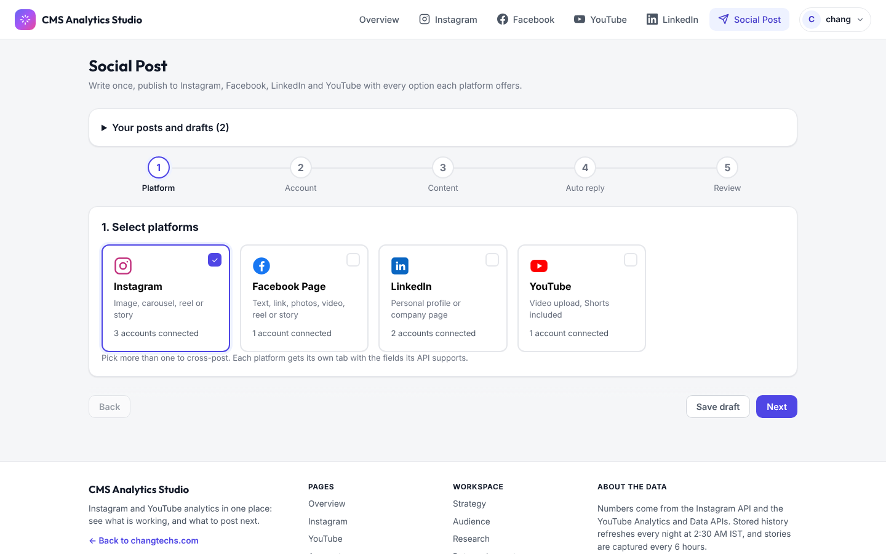

*Figure 20 — Social Post, step 1*

| # | Label | What to do |
|---|---|---|
| ① | Your posts and drafts | Click to reopen a draft, see scheduled/finished posts, or delete a draft. |
| ② | Steps | Shows where you are in the 5 steps. |
| ③ | Click to select | Click a platform card (tick appears). |
| ④ | Pick more to cross-post | Select several platforms to post the same content everywhere. |
| ⑤ | Save draft | Save and come back later. |
| ⑥ | Next step | Go to step 2. |

**Post types per platform**

| Platform | Post types |
|---|---|
| Instagram | Image, Carousel (2–10 items), Reel, Story |
| Facebook Page | Text, Link, Photo, Multi-photo, Video, Reel (3–90 s), Story |
| LinkedIn | Text only, Image, Multi-image (2–20), Video, Document (PDF), Article, Poll (2–4 options) |
| YouTube | Video (vertical, 3 minutes or less = Short) |

### Step 2 — Choose accounts

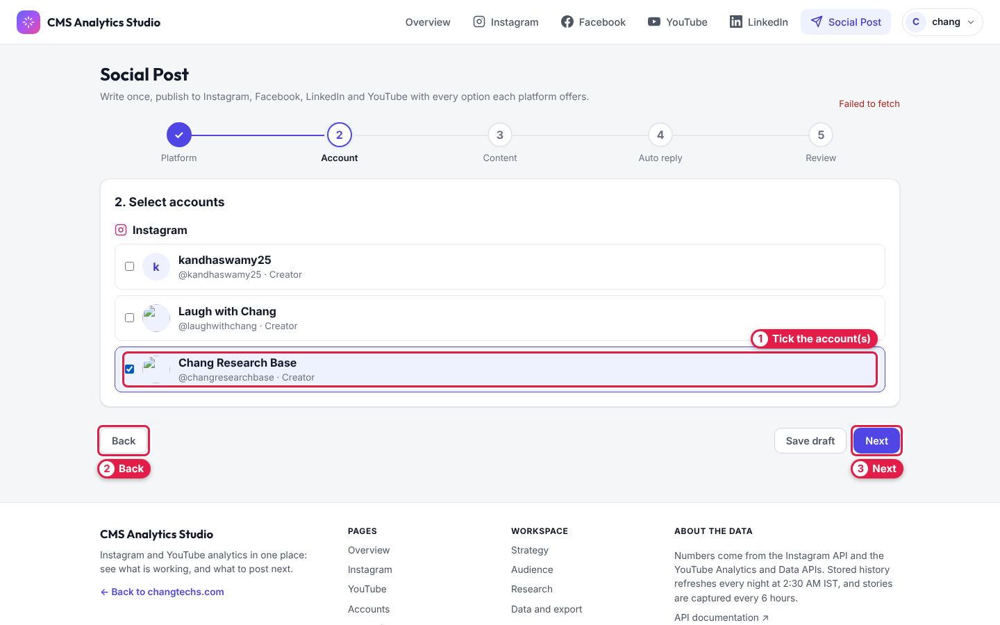

*Figure 21 — Social Post, step 2*

| # | Label | What to do |
|---|---|---|
| ① | Tick the account(s) | Pick which account(s) to post from. |
| ② | Back | Return to step 1. |
| ③ | Next | Go to step 3. |

### Step 3 — Write the post

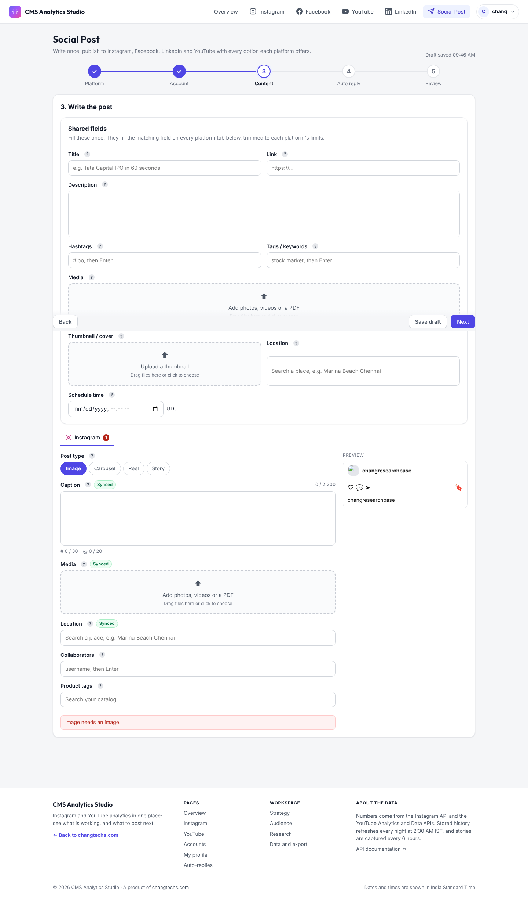

*Figure 22 — Social Post, step 3*

| # | Label | What to do |
|---|---|---|
| ① | Shared fields (fill once) | Title, link, description, hashtags, tags, media, thumbnail, location. They copy to every platform tab, trimmed to each platform's limits. |
| ② | Schedule (empty = now) | Leave empty to publish immediately, or pick a future date/time. Facebook schedules must be 10 minutes to 30 days ahead. |
| ③ | Platform tab | One tab per platform for its own options. A red number = something to fix (the message appears in red at the bottom of the tab). |
| ④ | Post type | e.g. Image, Carousel, Reel, Story. |
| ⑤ | Live preview | Roughly how the post will look. |
| ⑥ | Caption | Text for this platform. **Synced** = it follows the shared field. Counters show limits (e.g. `0 / 2,200`, `# 0 / 30`). |

Then click **Next**.

### Step 4 — Auto reply (Instagram only, optional)

Turn it on to answer comments on this new post automatically:

1. **Public reply under the comment** — up to 10 variants; one is chosen at random. `{username}` becomes @their_name.
2. **Private reply by DM** — message, link, up to 3 link buttons, quick replies. `{{link}}` places the link.
3. **Ask them to follow before sending the link** (optional) — they get an "I followed ✅" button; the link is sent after the app checks they follow.

### Step 5 — Review and publish

Check the summary, then click **Publish now** (or **Schedule for …**). You'll see live progress per platform (Upload → Create → Processing → Publish). If one platform fails, click **Retry** for just that platform.

---

## 10. Auto-replies (Instagram)

Open from **Account menu → Auto-replies** (Figure 3 → ③). When someone comments or DMs a keyword (e.g. "link"), the app sends them your message and URL automatically.

### Rules list

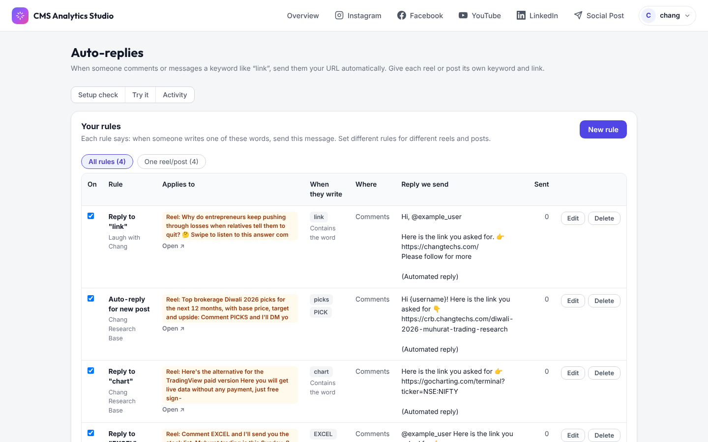

*Figure 23 — Auto-replies page*

| # | Label | What to do |
|---|---|---|
| ① | Setup check / Try it / Activity | Opens the tools in Figures 26–27. |
| ② | Create a rule | Click **New rule** (Figure 24). |
| ③ | Filter rules | All rules, or only rules for one reel/post. |
| ④ | On / off | Untick to pause a rule without deleting it. |
| ⑤ | Which reel / post | The content the rule applies to. **Open ↗** shows it on Instagram. |
| ⑥ | Keyword | The trigger word and how it's matched. |
| ⑦ | Reply sent | The message people receive. The **Sent** column counts replies sent. |
| ⑧ | Edit / Delete | Change or remove the rule. |

### Create a rule

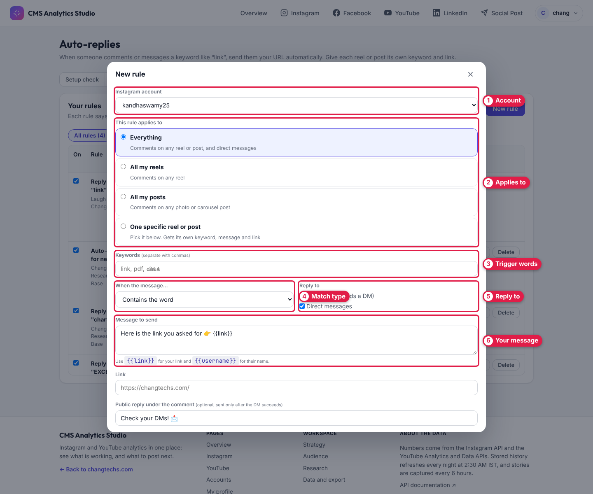

*Figure 24 — New rule (top half)*

| # | Label | What to do |
|---|---|---|
| ① | Account | Choose the Instagram account. |
| ② | Applies to | **Everything** (comments + DMs), **All my reels**, **All my posts**, or **One specific reel or post** (pick from thumbnails). |
| ③ | Trigger words | Keywords separated by commas, e.g. `link, pdf, லிங்க்`. |
| ④ | Match type | *Contains the word*, *Starts with*, or *Is exactly*. |
| ⑤ | Reply to | Comments (sends a DM) and/or Direct messages. |
| ⑥ | Your message | Use `{{link}}` for the link and `{{username}}` for their name. |

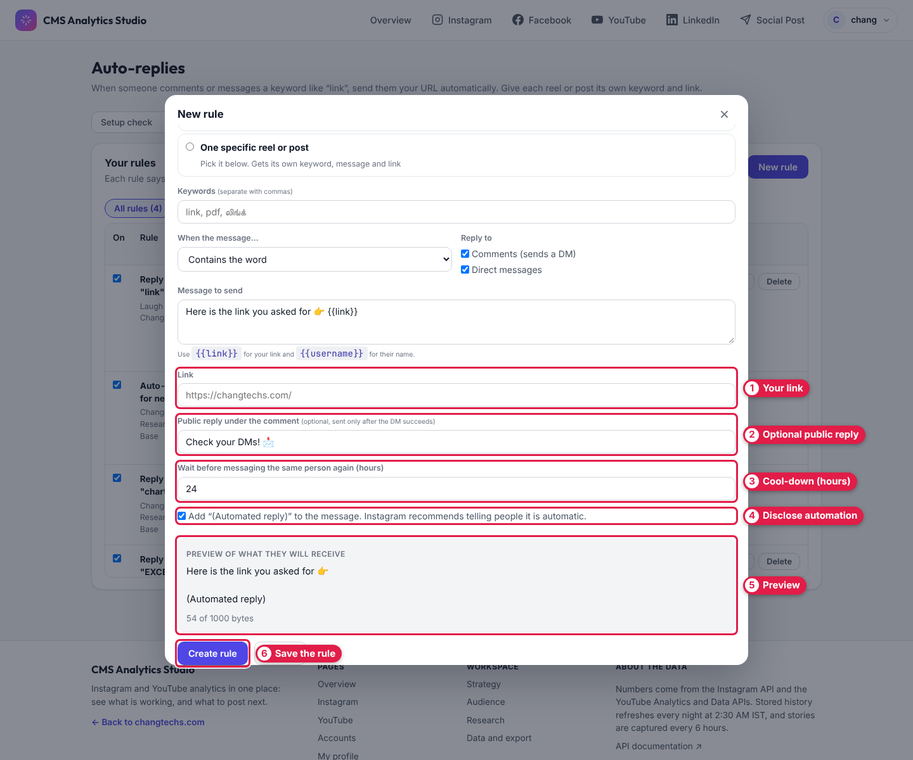

*Figure 25 — New rule (bottom half — scroll down in the form)*

| # | Label | What to do |
|---|---|---|
| ① | Your link | The URL to send (must start with https://). |
| ② | Optional public reply | A short public reply under the comment, posted only after the DM succeeds. |
| ③ | Cool-down (hours) | Don't message the same person again within this many hours. |
| ④ | Disclose automation | Adds "(Automated reply)" — recommended by Instagram. |
| ⑤ | Preview | Exactly what they will receive. |
| ⑥ | Save the rule | Click **Create rule**. |

**Which rule wins?** The most specific: one reel/post rule → all reels/posts rule → Everything rule. Reel/post rules only answer comments (a DM can't be linked to a post).

**Shortcut:** Instagram → Content → **Set up auto-reply for this reel** (Figure 8 → ⑦) opens this form already pointed at that post.

### Setup check

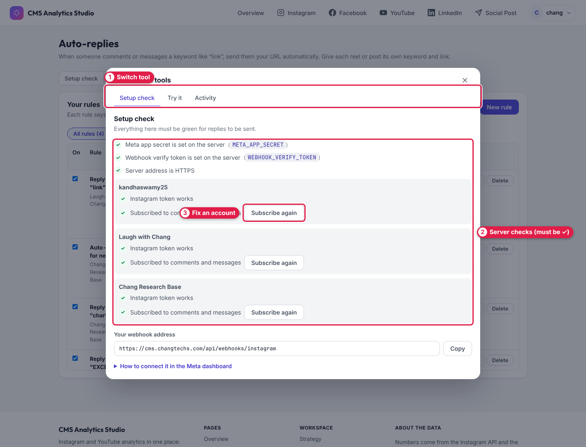

*Figure 26 — Automation tools → Setup check*

| # | Label | What to do |
|---|---|---|
| ① | Switch tool | Move between Setup check, Try it and Activity. |
| ② | Server checks (must be ✓) | Everything must be green ✓ for replies to be sent. |
| ③ | Fix an account | If an account shows ✕, click **Subscribe again**. |

### Try it (safe test)

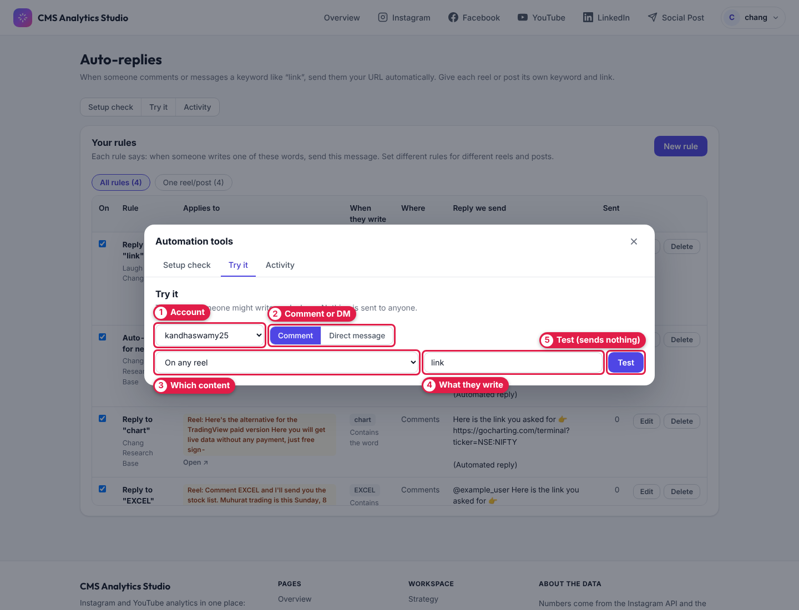

*Figure 27 — Automation tools → Try it*

| # | Label | What to do |
|---|---|---|
| ① | Account | Pick the account to test. |
| ② | Comment or DM | Simulate a comment or a direct message. |
| ③ | Which content | Any reel, any post, or a specific one. |
| ④ | What they write | Type a sample message, e.g. `link please`. |
| ⑤ | Test (sends nothing) | Shows which rule would answer and what would be sent. **Nothing is sent to anyone.** |

**Activity** (third tool) lists the latest messages handled, with Instagram's error code if something failed. Click **Refresh** to reload.

**Instagram's limits:** one private reply (DM) per comment, within **7 days** of the comment; DMs can be answered within **24 hours**.

---

## 11. Connected accounts

Open from **Account menu → Connected accounts** (Figure 3 → ②). Connect each platform once; connections renew themselves.

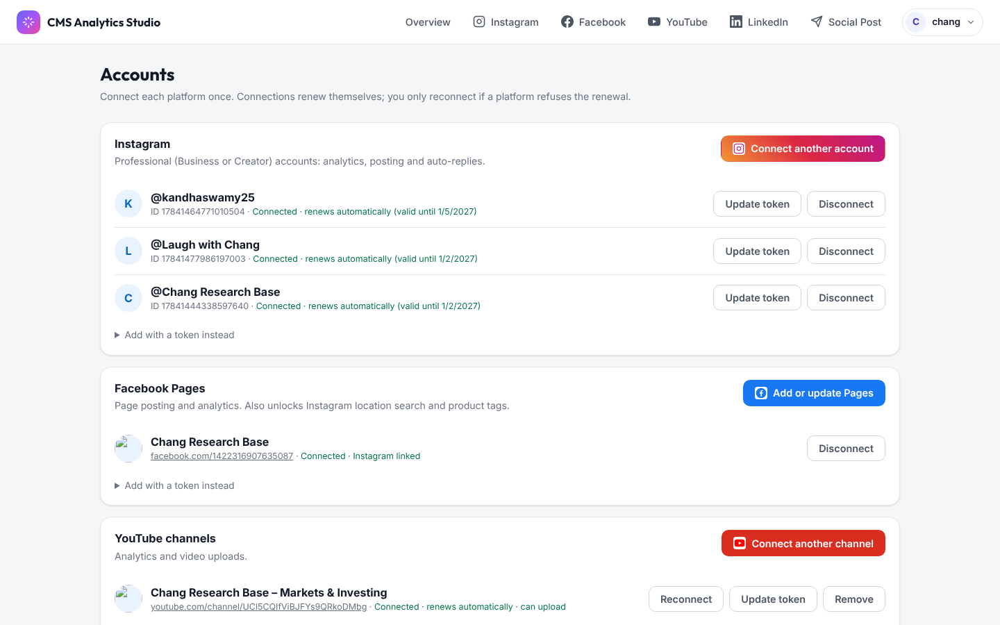

*Figure 28 — Accounts page (Instagram and Facebook)*

| # | Label | What to do |
|---|---|---|
| ① | Add Instagram account | Sign in with a Professional (Business or Creator) Instagram account. |
| ② | Connected account + status | Shows *Connected · renews automatically (valid until …)*. |
| ③ | Update token / Disconnect | Refresh a broken connection, or remove the account. |
| ④ | Advanced: paste a token | Add an account by pasting an access token (advanced users). |
| ⑤ | Add Facebook Pages | Sign in with a Facebook account that manages the Page and tick the Pages. Also enables Instagram location search and product tags. |

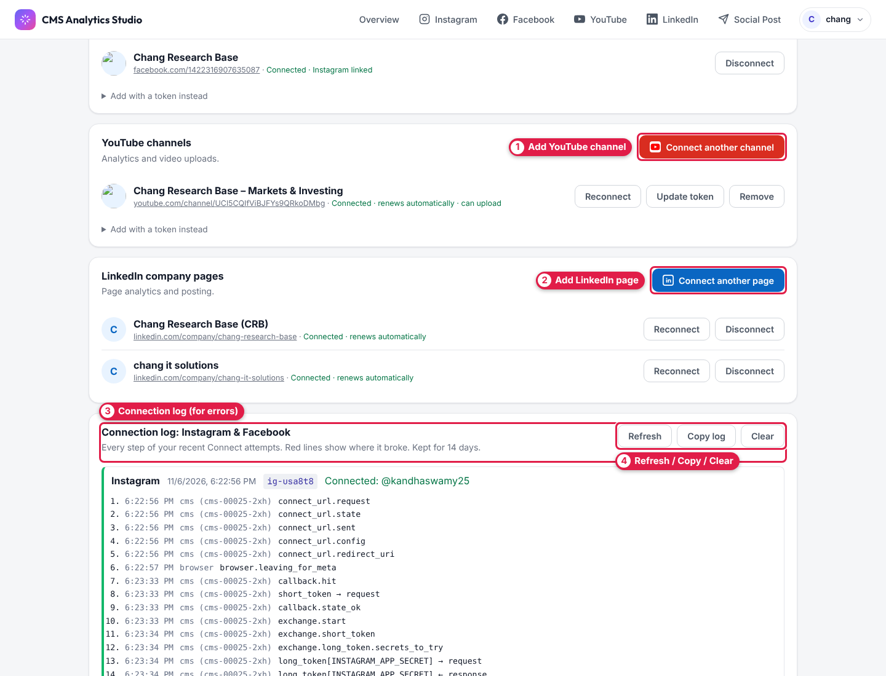

*Figure 29 — Accounts page (YouTube, LinkedIn, connection log)*

| # | Label | What to do |
|---|---|---|
| ① | Add YouTube channel | Sign in with the Google account that owns the channel. |
| ② | Add LinkedIn page | Sign in with a LinkedIn admin of the company page — all pages you manage are added. |
| ③ | Connection log (for errors) | Every step of recent Instagram/Facebook connect attempts (kept 14 days). Red lines show where it failed. |
| ④ | Refresh / Copy / Clear | **Copy log** to send it to support when a connection fails. |

---

## 12. My profile and logging out

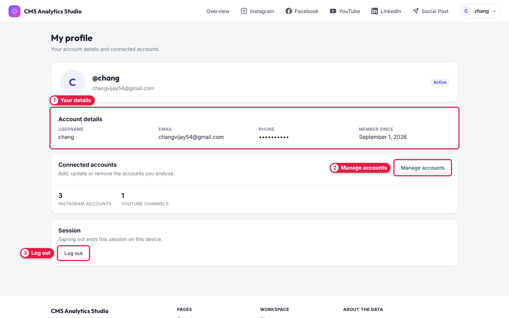

*Figure 30 — My profile*

| # | Label | What it does |
|---|---|---|
| ① | Your details | Username, email, phone, member since. |
| ② | Manage accounts | Shortcut to Connected accounts (Figure 28). |
| ③ | Log out | Ends your session on this device. |

---

## 13. How the data is updated

| When | What happens |
|---|---|
| Every night, 2:30 AM IST | Latest daily numbers are saved for every connected account. |
| Every 6 hours | Instagram stories are captured (Instagram deletes story numbers after 24 h). |
| Every minute | Scheduled posts are checked and sent at their time. |
| When you click **Update data** / **Update all data** | Numbers refresh immediately. |

Preset ranges (7/14/30 days) use saved history; **Custom** ranges are fetched live. All times are in **India Standard Time (IST)**.

---

## 14. Glossary

| Term | Meaning |
|---|---|
| **Reach** | Number of different accounts that saw your content. |
| **Views / Impressions** | Times content was shown or played (one person can count more than once). |
| **Interactions / Engagements** | Likes + comments + saves + shares (plus reactions/clicks where counted). |
| **Engagement rate** | Interactions as a share of views (or reach). |
| **Net followers** | New follows minus unfollows. |
| **Skip rate** | % of reel plays stopped in the first 3 seconds. Lower = better hook. |
| **Avg % viewed** | How much of each video people watched on average. |
| **Watch time** | Total minutes/hours watched. |
| **Link taps** | Taps on profile link/contact buttons. |
| **Red dot (unusual day)** | A day far outside your normal range (more than 2 standard deviations). |
| **vs prev period** | Compared with the same number of days just before. |

---

## 15. Troubleshooting and FAQ

**"No data stored yet for this period"** — press **Update data** (Figure 7 → ⑥). After that it refreshes every night.

**Audience/demographics are empty** — Instagram only shares these for accounts with 100+ followers.

**An account stopped updating** — Connected accounts → **Update token** or **Reconnect** (Figure 28 → ③).

**Auto-replies aren't being sent**
1. Setup check must be all green ✓ — click **Subscribe again** if not (Figure 26 → ③).
2. Rule must be **On** (Figure 23 → ④). Test it in **Try it** (Figure 27).
3. Look at **Activity** for Instagram's error code.
4. Limits: one DM per comment within 7 days; DMs answered within 24 hours.

**A post failed on one platform** — on the progress screen click **Retry** for that platform, or reopen it from **Your posts and drafts** (Figure 20 → ①).

**Red number on a platform tab / "Image needs an image"** — each post type needs the right media (e.g. Reel = one video, Carousel = 2–10 items). Fix the red message and the number disappears.

**Times look wrong** — all times are in India Standard Time (IST).

**Forgot password** — contact your administrator.
