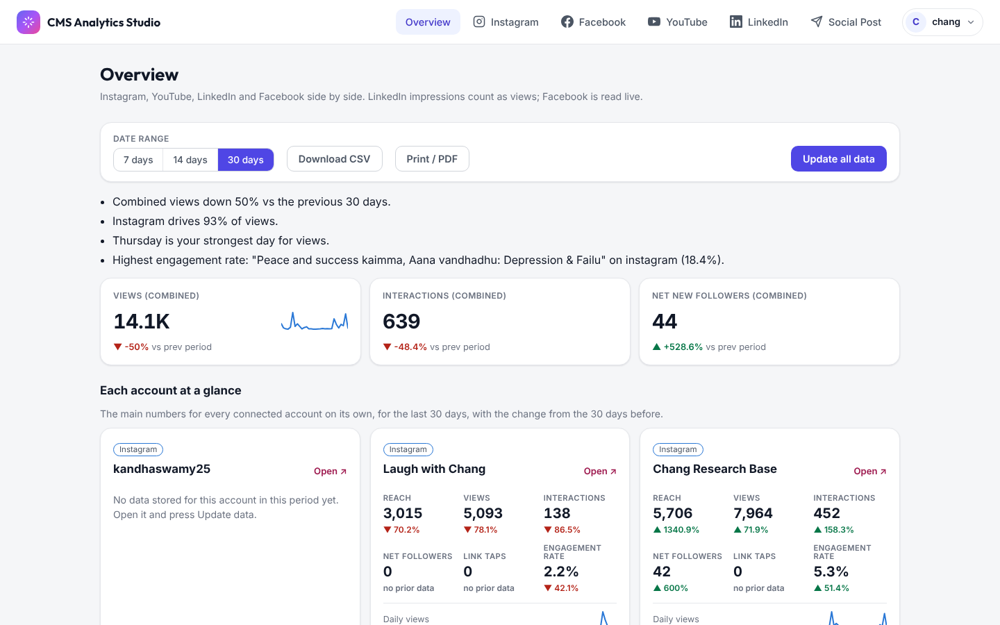
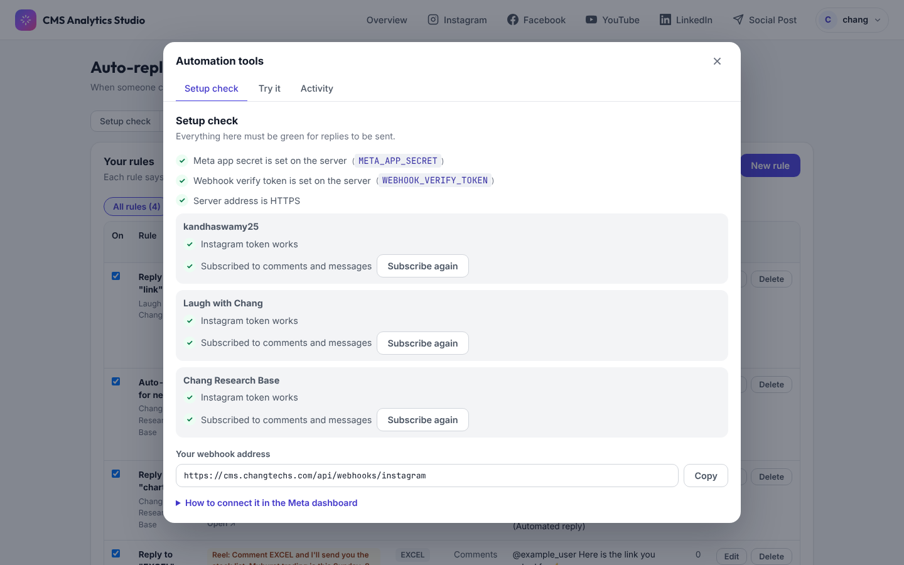
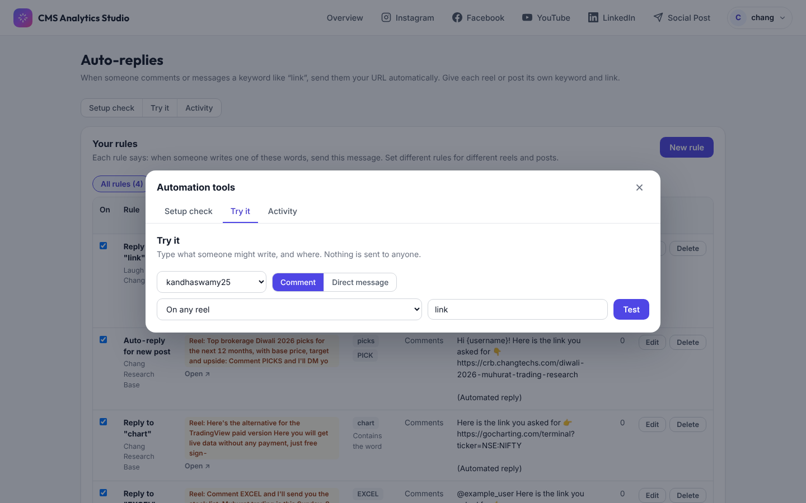

# CMS Analytics Studio — User Guide

CMS Analytics Studio puts your **Instagram, Facebook, YouTube and LinkedIn** numbers in one place, lets you **publish one post to all of them**, and **auto-replies on Instagram** when someone comments or messages a keyword like "link".

Web address: **https://cms.changtechs.com**

---

## Contents

1. [Signing in](#1-signing-in)
2. [Finding your way around](#2-finding-your-way-around)
3. [Overview — all platforms at once](#3-overview--all-platforms-at-once)
4. [Platform workspaces (common controls)](#4-platform-workspaces-common-controls)
5. [Instagram](#5-instagram)
6. [Facebook](#6-facebook)
7. [YouTube](#7-youtube)
8. [LinkedIn](#8-linkedin)
9. [Social Post — publish everywhere](#9-social-post--publish-everywhere)
10. [Auto-replies (Instagram)](#10-auto-replies-instagram)
11. [Connected accounts](#11-connected-accounts)
12. [My profile and logging out](#12-my-profile-and-logging-out)
13. [How the data is updated](#13-how-the-data-is-updated)
14. [Glossary](#14-glossary)
15. [Troubleshooting and FAQ](#15-troubleshooting-and-faq)

---

## 1. Signing in

1. Open **https://cms.changtechs.com**.
2. Enter your **username or email** and your **password**. Use the eye icon to show the password while typing.
3. Click **Sign In to Dashboard →**. You land on the **Overview** page.

- You stay signed in on this browser until you log out or your session expires.
- **Forgot password?** Passwords are reset by your administrator. Contact them for a new one.

---

## 2. Finding your way around

The bar at the top of every page has:

| Item | What it opens |
|---|---|
| **Overview** | All connected accounts side by side |
| **Instagram / Facebook / YouTube / LinkedIn** | That platform's workspace with detailed analytics |
| **Social Post** | Write and publish (or schedule) a post to one or more platforms |
| **Your name (top right)** | Account menu: *My profile*, *Connected accounts*, *Auto-replies*, *Log out* |

On a phone, tap the **☰** icon to open the menu.

The footer repeats the main links and notes that **all dates and times are in India Standard Time (IST)**.

---

## 3. Overview — all platforms at once

The Overview compares every connected account for the chosen period.

**Controls at the top**

- **Date range:** 7, 14 or 30 days. Every number is compared with the period just before it (for example, the last 30 days vs the 30 days before that).
- **Download CSV:** the numbers as a spreadsheet file (opens in Excel or Google Sheets).
- **Print / PDF:** print the page or save it as a PDF from the print dialog.
- **Update all data:** fetch the latest numbers from every platform now, instead of waiting for the nightly update.

**What you see**

- **Quick insights** — plain sentences such as "Instagram drives 93% of views" or "Thursday is your strongest day for views".
- **Combined totals** — views, interactions and net new followers across all platforms, with ▲/▼ change vs the previous period.
- **Each account at a glance** — one card per account with its key numbers and a small daily chart. Click **Open ↗** to jump to that account's workspace. If a card says *No data stored for this account in this period yet*, open it and press **Update data**.
- **Daily views by platform** and **Share of views** charts.
- **Platform comparison** table — views, interactions and new followers per platform.
- **Best content by engagement rate** — your top posts and videos (with at least 100 views) across all platforms.

> LinkedIn *impressions* are counted as views here. Facebook numbers are read live.

---

## 4. Platform workspaces (common controls)

Every platform page (Instagram, Facebook, YouTube, LinkedIn) works the same way:

1. **Profile header** — the account's name, bio and lifetime numbers (followers, posts, etc.).
2. **Account** — if you have more than one account on this platform, choose which one to view.
3. **Date range** — 7, 14, 30 days, or **Custom** to pick exact start and end dates. Custom ranges are read live from the platform, so they can take a little longer.
4. **Data updated … ago / Update data** — shows when the numbers were last refreshed. Press **Update data** to refresh now (takes a few seconds).
5. **Tabs** — Overview, Content, Audience, Strategy, Research, Data (the exact tabs differ slightly per platform).

**Reading the number cards**

- The big number is the total for the chosen period.
- ▲ green / ▼ red shows the change vs the previous period of the same length. *"no prior data"* means there is nothing to compare with yet.
- The small line is the daily trend.
- Hover or tap the **?** next to a name for a short explanation of that metric.

---

## 5. Instagram

### Overview tab

Reach, views, interactions, accounts engaged, net followers, link taps and engagement rate, plus:

- **Reels at a glance** — how many reels were measured, skip rate, average and total watch time.
- **Stories at a glance** — stories saved, average views, exit rate, replies, link clicks.
- **What your data says** — plain-language takeaways (growth, strongest weekday, unusual spikes, best performer).
- **More numbers** — likes, comments, saves, shares, story replies, reposts, profile views.

### Content tab

Every post, reel, carousel and saved story with its own numbers.

- **Stories live right now** — Instagram only keeps story numbers for 24 hours. Each time data is updated, current stories are saved so you keep their history.
- **Search** captions, **Sort by** (newest, most views, best engagement rate, most likes/comments/saves/shares, lowest skip rate, longest watch time), switch between **Grid** and **List**, and filter by **All posts / Reels / Stories / Carousels**.
- On each post: **Open on Instagram ↗**, **Set up auto-reply for this reel →** (opens the auto-reply form already pointed at that post — see [section 10](#10-auto-replies-instagram)), and **Comment insights**.

### Audience tab

- Reach and views split between **followers and non-followers** (a high non-follower share means new people are discovering you).
- Views, reach, interactions, likes, saves, shares and comments **by format** (reels, posts, stories).
- Follows vs unfollows, profile link taps.
- **Best time to post** — a heat map of when your followers are online.
- **Who follows you** and **Who engages with you** — age, gender, top countries and cities.

> Instagram only shares demographics and follower-activity data for accounts with **at least 100 followers**.

### Strategy tab

- **Your action plan** — recommendations built from your own results, ranked *High priority*, *Medium* and *Nice to have*, each with the numbers behind it (e.g. "Your reel hooks are losing people in the first 3 seconds", "Post more consistently").
- **Reel hooks: skip rate** — how many viewers leave in the first 3 seconds, with **Hooks to copy** (lowest skip rate) and **Hooks to rework** (highest skip rate).
- **Format scorecard** — reels vs carousels vs images side by side: views, engagement, save rate, share rate, follows per 1,000 reach.

### Research tab

- **Compare with another account** — enter any public Instagram Business or Creator username to compare audience, posting rhythm and engagement with yours.
- **Hashtag research** — see the top posts under a hashtag before you use it. Instagram allows **30 different hashtag searches per week**.
- **Posts that tag you** — content others made about you (good for reposting and thanking creators).
- **Publishing quota** — how many posts this account has published through the app in the last 24 hours, out of Instagram's limit (100).

### Data tab

One row per day exactly as stored. Press **Download CSV** to open it in Excel or Google Sheets.

---

## 6. Facebook

Tabs: **Overview, Content, Video & Reels, Audience**.

- **Overview** — views, reach, engagements, reactions, page visits, actions on Page, net followers, engagement rate and new conversations. The **Views per day** chart has a drop-down to switch metric. Also: followers vs non-followers, organic vs ads, reactions by type, views by weekday, and **Page at a glance** (lifetime followers, likes, check-ins, rating, verified status).
- **Content** — every post in the period with views, reach, reactions, comments, shares, clicks and engagement rate. Sort by most views, reach, engagement, interactions, clicks or newest. Also shows **what kind of post works best**, **best day** and **best time** to post.
- **Video & Reels** — video views, minutes watched, 30-second views, repeat views, autoplayed vs click-to-play, organic vs paid, and a per-reel table (plays, replays, average watch, % watched, followers gained).
- **Audience** — who your Page reaches.

---

## 7. YouTube

Tabs: **Overview, Content, Audience, Strategy, Research, Data**.

- **Overview** — views, engaged views, watch time, average % of video viewed, subscribers gained/lost, likes, comments, engagement rate, and **What your data says**.
  - **Views over time** chart — pick any metric from the drop-down. Tick **Show 7-day forecast** for a projection. **Red dots** mark unusual days (far outside your normal range).
  - **How people engage** (daily likes, comments, shares) and **Best days of the week**.
- **Content** — every video with views, likes, comments and length. Search, sort, Grid/List view, **Open on YouTube ↗** and **Comment insights**.
- **Audience** — who watches your channel.
- **Strategy** — an action plan (e.g. "Viewers leave early"), **Does video length matter?**, videos that win subscribers, videos that lose viewers early, and **title patterns** (length, numbers, questions, upload day).
- **Research** and **Data** — research tools and the daily table with **Download CSV**.

> A note like *"Showing 27 of 30 days. The rest are not stored yet."* means a few days haven't been saved yet; press **Update data** or wait for the nightly update.

---

## 8. LinkedIn

For LinkedIn **company pages**. Tabs: **Overview, Content, Audience, Data**. Use **Account** to switch between pages.

- **Overview** — impressions, unique impressions, clicks, reactions, comments, reposts, new followers, page views, engagement rate, plus trend chart, forecast and best weekdays.
- **Content** — each post with impressions, clicks, click-through rate, reactions, comments and reposts. Filter by **Photo posts / Articles**, search and sort.
- **Audience** — who follows your page.
- **Data** — daily table with **Download CSV**.

> LinkedIn keeps 12 months of daily history and can lag by a day or two.

---

## 9. Social Post — publish everywhere

Write a post once and publish or schedule it to Instagram, Facebook, LinkedIn and YouTube. The wizard has up to five steps shown at the top: **Platform → Account → Content → Auto reply → Review**.

Your work is **saved as a draft automatically**. You can also press **Save draft** at any time.

### Step 1 — Platform

Click one or more platforms. Pick more than one to cross-post.

| Platform | Post types |
|---|---|
| Instagram | Image, Carousel (2–10 items), Reel, Story |
| Facebook Page | Text, Link, Photo, Multi-photo, Video, Reel (3–90 s), Story |
| LinkedIn | Text only, Image, Multi-image (2–20), Video, Document (PDF), Article, Poll (2–4 options) |
| YouTube | Video (vertical videos of 3 minutes or less become Shorts) |

### Step 2 — Account

Tick the account(s) to post from on each platform.

### Step 3 — Content

- **Shared fields** — fill Title, Link, Description, Hashtags, Tags/keywords, Media, Thumbnail, Location and **Schedule time** once. They copy into each platform's tab, trimmed to that platform's limits. Fields marked **Synced** follow the shared value.
- **Platform tabs** — one tab per platform for its own options (post type, caption, collaborators, product tags, privacy, playlist, etc.). A red number on a tab means something needs fixing; the message is shown in red at the bottom of the tab.
- **Preview** on the right shows roughly how the post will look.
- **Media** — drag files in or click to choose. Character counters (e.g. `0 / 2,200`) and hashtag/mention counters help you stay within limits.

**Scheduling:** leave *Schedule time* empty to publish immediately. Set a time to schedule it. The time must be in the future; Facebook scheduled posts must be **10 minutes to 30 days** ahead. Some platforms schedule natively; for others the app posts it at that time.

### Step 4 — Auto reply (Instagram only)

Optional. Turn it on to answer comments on this new post automatically:

1. **Public reply under the comment** — add up to 10 variants; one is picked at random per comment so replies don't look like spam. `{username}` becomes @their_name.
2. **Private reply by DM** — DM text, a link, up to 3 link buttons and quick-reply suggestions. `{{link}}` places the link; if left out, the link is added at the end.
3. **Ask them to follow before sending the link** (optional) — the first DM asks them to follow and shows an "I followed ✅" button. When they tap it, the app checks and then sends the link.

### Step 5 — Review and publish

Check the summary for each platform, then click **Publish now** (or **Schedule for …** if you set a time).

After sending, you see **live progress per platform** (Upload → Create → Processing → Publish). If one platform fails, the error is shown with a **Retry** button for just that platform.

### Your posts and drafts

Click **Your posts and drafts** at the top of the page to reopen a draft, see scheduled/finished posts, or **Delete** a draft.

---

## 10. Auto-replies (Instagram)

Open from the account menu → **Auto-replies**.

When someone comments or sends a DM containing a keyword (e.g. "link"), the app automatically sends them your message and URL.

### Your rules

The table lists every rule: on/off switch, rule name, which content it applies to, keywords, where (comments / DMs), the reply text, and how many were **Sent**. Use **Edit** or **Delete** on each row. Filter with **All rules** / **One reel/post**.

### Create a rule

Click **New rule**:

1. **Instagram account** — which account the rule is for.
2. **This rule applies to**
   - *Everything* — comments on any reel or post, and direct messages
   - *All my reels*
   - *All my posts* (photos and carousels)
   - *One specific reel or post* — pick it from the thumbnail list
3. **Keywords** — separate with commas (e.g. `link, pdf, லிங்க்`).
4. **When the message…** — *Contains the word*, *Starts with*, or *Is exactly*.
5. **Reply to** — *Comments (sends a DM)* and/or *Direct messages*.
6. **Message to send** — use `{{link}}` for your link and `{{username}}` for their name.
7. **Link** — the URL to send.
8. **Public reply under the comment** (optional) — posted only after the DM succeeds.
9. **Wait before messaging the same person again (hours)** — avoids repeat messages.
10. **Add "(Automated reply)"** — recommended by Instagram.
11. Check the **Preview**, then click **Create rule**.

**Which rule wins?** The most specific one: a rule for one reel beats an "all reels" rule, which beats an "Everything" rule. Reel/post rules only answer comments, because a DM can't be linked to a particular post.

**Shortcut:** on Instagram → **Content**, click **Set up auto-reply for this reel →** under any post to open this form already pointed at it.

### Automation tools

The buttons at the top of the page open three tools:

- **Setup check** — everything must be green (✓) for replies to be sent: server settings, HTTPS, and for each account *Instagram token works* and *Subscribed to comments and messages*. Use **Subscribe again** if an account shows ✕.

  

- **Try it** — type what someone might write, choose comment or DM and which content, and press **Test**. It shows which rule would answer and what would be sent. **Nothing is sent to anyone.**

  

- **Activity** — the latest messages the automation handled, including Instagram's error code when something fails. Press **Refresh** to reload.

**Instagram's limits to know**

- A comment can get **one private reply (DM)**, and only **within 7 days** of the comment.
- A DM can be answered **within 24 hours**.

---

## 11. Connected accounts

Open from the account menu → **Connected accounts**.

Connect each platform once. Connections **renew themselves**; you only reconnect if a platform refuses the renewal.

| Section | Button | What you need |
|---|---|---|
| **Instagram** | Connect another account | A Professional (Business or Creator) Instagram account. Sign in with Instagram. |
| **Facebook Pages** | Add or update Pages | Sign in with a Facebook account that manages the Page and tick the Pages. Also unlocks Instagram location search and product tags. |
| **YouTube channels** | Connect another channel | Sign in with the Google account that owns the channel. |
| **LinkedIn company pages** | Connect another page | Sign in with a LinkedIn account that is an admin of the page. Every page you manage is added. |

Each connected account shows its status (e.g. *Connected · renews automatically (valid until …)*) and buttons:

- **Update token / Reconnect** — refresh the connection if it stopped working.
- **Disconnect / Remove** — remove the account from the app.
- **Add with a token instead** — advanced: paste an access token manually.

**Connection log: Instagram & Facebook** — every step of recent connect attempts, kept for 14 days. Red lines show where a connection failed. Use **Copy log** to send it to support, or **Clear**.

---

## 12. My profile and logging out

Account menu → **My profile** shows your username, email, phone, member-since date, how many accounts are connected (with a **Manage accounts** shortcut), and a **Log out** button.

To log out from anywhere: click your name (top right) → **Log out**.

---

## 13. How the data is updated

- **Every night at 2:30 AM IST** the app saves the latest daily numbers from every connected account.
- **Instagram stories are captured every 6 hours** (Instagram deletes story numbers after 24 hours).
- **Update data** (on a platform page) or **Update all data** (on Overview) refreshes immediately.
- Scheduled posts are checked every minute and sent at their time.
- Preset ranges (7/14/30 days) read the saved history; **Custom** ranges are fetched live from the platform.

---

## 14. Glossary

| Term | Meaning |
|---|---|
| **Reach** | Number of different accounts that saw your content. |
| **Views / Impressions** | How many times content was shown or played. One person can count more than once. |
| **Interactions / Engagements** | Likes + comments + saves + shares (and reactions/clicks where the platform counts them). |
| **Engagement rate** | Interactions as a share of views (or reach, depending on platform). |
| **Net followers** | New follows minus unfollows. |
| **Skip rate** | Share of reel plays abandoned in the first 3 seconds. Lower is better; it measures your hook. |
| **Avg % viewed** | On average, how much of each video people watched. |
| **Watch time** | Total minutes/hours watched. |
| **Link taps** | Taps on the link/contact buttons on your profile. |
| **Unusual spike (red dot)** | A day more than 2 standard deviations away from your normal range. |
| **vs prev period** | Compared with the same number of days immediately before the selected range. |

---

## 15. Troubleshooting and FAQ

**"No data stored yet for this period"**
Press **Update data** on that account's page. After that it refreshes automatically every night.

**Audience/demographics are empty**
Instagram only provides demographics and "best time to post" for accounts with at least 100 followers.

**An account shows an error or stopped updating**
Go to **Connected accounts** and press **Update token** or **Reconnect** for it. Instagram tokens normally renew themselves; if a renewal is refused you'll need to reconnect.

**Auto-replies aren't being sent**
1. Open **Auto-replies → Setup check**. Everything must be green; press **Subscribe again** for any account showing ✕.
2. Check the rule is switched **On** and the keyword/match type is right — test it in **Try it**.
3. Check **Activity** for Instagram's error code.
4. Remember the limits: one DM per comment, within 7 days; DMs answered within 24 hours.

**A post failed on one platform**
On the progress screen, read the error and press **Retry** for that platform. You can also reopen it from **Your posts and drafts**.

**"Image needs an image" / red numbers on platform tabs**
Each post type needs the right media (e.g. Reel = one video, Carousel = 2–10 items). Fix the item listed in red and the number disappears.

**Times look wrong**
All dates and times in the app are shown in **India Standard Time (IST)**.

**I forgot my password**
Contact your administrator to reset it.
